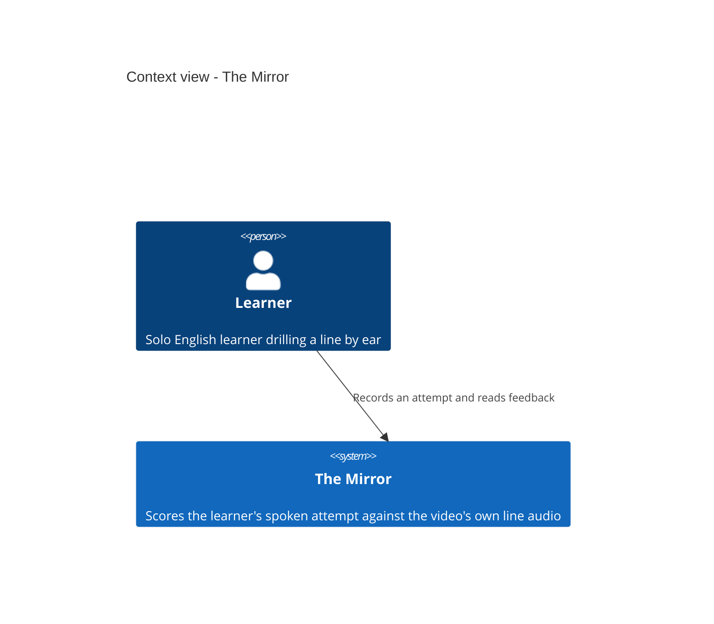
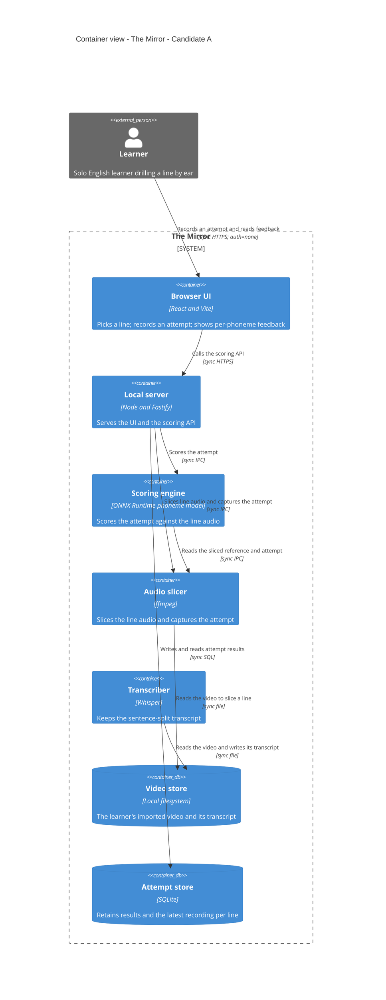

# The Mirror — speech scoring on your own video lines

## Context & Background

A solo English learner studies from real videos they chose themselves and learns by ear: reading is not their bottleneck, speaking is. Today they can replay a line as many times as they like, but nothing tells them how close their own voice came to the native speaker's. There is no teacher to say "close enough", so the learner practises on hope and cannot tell improvement from repetition. The Mirror is the missing half — feedback: the learner records an attempt at a line, and the app says which sounds matched the native speaker and which did not.

### Business objectives

- Let a solo learner tell improvement from repetition, so practice turns into learning instead of passive watching.
- Never gate the learner on a score: feedback is information, not a pass mark.
- Keep everything local and private — no upload, no account, no cost, no network after setup.

### Constraints

- The score never gates the learner, and no learner audio ever leaves the machine — both are standing, non-negotiable.
- The existing transcription in `listen-to-me` must keep working; the change must not break it.
- Free, local, single-user: a personal tool, not a commercial product. No OKRs and no market-sizing are invented for it.
- Runs on the learner's own machine (macOS, Node 22.12+), reached through a browser pointed at a local server.

## Scope & Requirements

### In scope

Record an attempt at a selected line, score it against that line's own audio from the video, show per-phoneme feedback with a match count, keep a history of attempts per line, and reveal a Chinese meaning on demand. Also in scope: loop a line or a run of consecutive lines for listening by ear.

### Functional requirements

| id | Functional requirement | Priority |
|---|---|---|
| fr-1 | Loop one line or a run of consecutive lines until the learner stops | core |
| fr-2 | Record an attempt at the selected line, with local-only storage and clear failure reporting | core |
| fr-3 | Score the attempt against the video's own line audio, locally | core |
| fr-4 | Report per-phoneme substitutions and a match count, with no percentage or grade | core |
| fr-5 | Keep a record of attempts per line; only the latest recording is retained | core |
| fr-6 | Reveal the Chinese meaning of a line on demand, hidden by default | core |

### Non-functional requirements

| Axis | Target | Rationale |
|---|---|---|
| correctness | The reference is the line's own audio sliced from the video, never TTS or a stock voice | a fair comparison needs the native speaker saying that exact sentence |
| correctness | The score never blocks the learner from continuing | a standing product decision; feedback is a coach, not a gate |
| privacy | No learner audio leaves the machine, ever | standing guardrail; everything runs locally |
| reliability | Existing Whisper transcription keeps working | the transcript is the reference's sentence boundary; breaking it breaks scoring |
| latency | Model loads in well under a second and scores a few seconds of audio in roughly a tenth of a second | measured in the probe; interactive feel on a local machine |
| footprint | The scoring model artifact fits on an ordinary machine | measured artifact sizes below; the fp32 model is quantized once at build time |

### Top three characteristics

Top three characteristics: **reliability**, **simplicity**, **privacy** (assumed, derived from the guardrails). Reliability because a score that misleads is worse than no score, and the existing transcription must not regress. Simplicity because a single local process on one machine must be operable by its owner. Privacy because "no audio leaves the machine" is a hard boundary, not a preference. Deliberately *not* in the top three: scalability and elasticity — there is one user and nothing to scale.

### Out of scope

Accounts, sign-in, and multi-device sync · hosted or cloud speech scoring and any upload of learner audio · cloud-drive import (Google Drive, Baidu, Tencent) · languages other than English · dedicated accent drills and phoneme practice modes · score-gated progression · a new player, transcript pipeline, or translation system (`listen-to-me` and free tools already provide these) · native mobile apps · scoring a run of lines as one unit.

### Accepted conflicts

- Per-phoneme detail requires the larger IPA model, which needs a one-time Python conversion and a ~1.26 GB download; the lighter character-level model ships ready but gives coarser feedback. Accepted: pay the build-time cost for phoneme fidelity, and keep the character model as a fallback if the artifact proves impractical to ship.
- A scoring model that runs locally is bounded by the machine's CPU and memory; accuracy on real human speech is unproven even though the mechanics (download, local execution, alignment) work. Accepted: ship the mechanics and treat accuracy as the load-bearing unknown, measured by agreement with the learner's own judgement.

### Estimates

Given as measurement (from the probe, cited in the PRD): model load 356 ms · inference 81 ms for 2 s of audio on CPU · phoneme model 1.26 GB fp32 (target ~320 MB int8) · character fallback 95 MB.

Assumed, each falsifiable: a line is a few seconds of audio · an attempt recording is a few hundred KB and only the latest per line is kept · one learner, one machine.

| Metric | Value | Derivation |
|---|---|---|
| scoring latency per line | < 1 s | 356 ms load amortized + 81 ms per 2 s of audio, proportional to line length |
| model artifact (phoneme) | ~320 MB on disk | 1.26 GB fp32 → int8 quantization, a build-time step |
| model artifact (fallback) | 95 MB | the official character-level ONNX, no conversion |
| per-attempt storage | results a few hundred bytes; latest recording a few hundred KB | only the latest recording per line is retained |
| steady-state load | n/a | single user, one machine; there is no QPS to size |

## Solution Design

Structure diagram: C4Context + C4Container
Why: C4 keeps the local process and its data owned by the system, with the learner and the machine's files outside the boundary.

### Current state

No implementation of the Mirror exists. The host app `listen-to-me` already imports a local video, auto-transcribes it with Whisper, shows a synced sentence list, seeks to a clicked line, and loops one sentence; the scoring half is the gap. Those existing pieces — Fastify server, React/Vite browser UI, SQLite storage, `ffmpeg-static` audio extraction, and the `@huggingface/transformers` + `onnxruntime-node` runtime — are described from the PRD and treated as the fixed substrate.

### Future state

The learner picks a line, records an attempt, and the app compares that attempt to the line's own audio through the same local model, reporting named phoneme substitutions and a match count. Feedback never gates. The only build-time dependency is a one-time model artifact download; at runtime the app needs no network.

### High-level solution design

### Conceptual design

The reference already exists in the learner's own file: the native speaker saying exactly that sentence. No text-to-speech, no cloud service, no synthetic reference. Both the reference and the attempt pass through the same local model, and the comparison is between two recordings of the same sentence. A true IPA phoneme recognizer (`facebook/wav2vec2-lv-60-espeak-cv-ft`) names the substitution per phoneme — "you said /s/ where /θ/ was expected" — and reports a match count, with no percentage and no grade.

### Candidate architectures

#### A — Local phoneme scoring against the line's own audio

The chosen path. The learner's machine hosts everything: the browser UI, a local server, an audio slicer, the scoring engine running the phoneme model through ONNX Runtime, and the attempt store. The reference is the line's audio sliced from the video, so the comparison is always against the right target.

**Pros:** honest reference (the speaker's own line), per-phoneme detail, runs entirely local, no runtime network. **Cons:** accuracy on real human speech is unproven; the artifact needs a one-time Python conversion and quantization.

The character-level fallback (`Xenova/wav2vec2-base-960h`, 95 MB, official ONNX, no conversion) is not drawn as a peer: it differs only in feedback granularity, loses the per-phoneme naming the product is built around, and remains a build-time fallback if the phoneme artifact proves impractical to ship. It is recorded in Key Design Decisions rather than rated alongside the chosen candidate.

### Trade-offs, migration, and ratings

- **Pros/cons:** the single candidate above carries its honest weakness (accuracy unproven).
- **Migration:** greenfield for the Mirror; the host app's existing transcript path is preserved, and the change adds scoring beside it rather than replacing it.
- **Ratings:** one candidate; a multi-candidate rating table adds no information when only one path survives the product decision.

## Data Sets & Data Model

### Core entities and invariants

- **Video** — the learner's imported file; its identity is the local path. Invariant: the transcript is cached and must keep working.
- **Line** — a sentence boundary within the video (start/end time, text, optional Chinese meaning). Invariant: the scoring reference is this line's own audio, not TTS.
- **Attempt** — a recording of the learner saying a line plus its result. Invariant: only the latest recording per line is kept; results are retained indefinitely.

### Data and consistency model

Single-user, single-process: SQLite is the one authority for attempts and results; the filesystem is the authority for the video and the transcript cache. There is no concurrency beyond one local server, so ordering is trivially serializable. The scoring result is a derived view of the attempt and is stored with it; the match count and substitution list are what the primary success metric reads back.

### Database schemas

- `Line — id, videoId, startMs, endMs, text, meaningZh, PRIMARY KEY(id)`
- `Attempt — id, lineId, recordedAt, resultJson, modelId, PRIMARY KEY(id)` — `resultJson` holds the substitution list and match count (a few hundred bytes); the recording file is stored on disk with only the latest retained per line.

## Key Design Decisions

### Decision log

| Decision | Alternative that lost | What closed it |
|---|---|---|
| Reference is the video's own line audio | Phonemes derived from the transcript | The speaker saying that exact sentence is the fair target; transcript-derived phonemes are less honest and were not achievable with the character model alone |
| Phoneme model `wav2vec2-lv-60-espeak-cv-ft`, converted to ONNX at build time | Character-level `Xenova/wav2vec2-base-960h` | Per-phoneme substitution naming is the product; character-level loses it. The character model stays a fallback |
| Feedback is named substitutions plus a match count | Binary match, or a graded number alone | Naming the habit is actionable; a bare number says something went wrong but not what to fix; the score never gates |
| Score one line at a time | Score a run of lines as one unit | Substitutions are only actionable when they point at one line's sounds; run-level scoring needs automatic segmentation |
| Retain all results, latest recording only | Keep all recordings | Results are a few hundred bytes; recordings are the bulk and lose value once scored |
| Everything local, no upload, no account | Hosted scoring | Free, local, private are standing constraints; no audio may leave the machine |

### Interface contracts

- **Scoring API:** `POST /score` with the line and the attempt recording; returns the substitution list and match count. Synchronous, local, no retry semantics needed beyond the browser.
- **Audio slicing:** the slicer returns the line's audio span from the video; if the reference is unusable (music, noise, silence), the app says so instead of scoring.

## Technology Impacts

- **Assumptions:** accuracy on real human speech is unproven; the probe proved mechanics on synthetic and near-miss signals only.
- **Delivery risks:** the model download path (resolved to ModelScope) and the one-time Python conversion; quantization of the 1.26 GB artifact to ~320 MB.
- **Cost, licensing, and team impacts:** one large download and one build-time conversion; the app itself needs only Node at runtime.
- **What breaks first:** scoring accuracy on real speech — a score that disagrees with the learner's own judgement too often is untrustworthy, and a misleading score is worse than none.

## Data Classifications

| Data set | Sensitivity | Retention / deletion |
|---|---|---|
| Attempt recordings (voice) | Personal, potentially biometric | Only the latest per line; deleted after scoring |
| Attempt results | Personal (learning history) | Retained indefinitely; a few hundred bytes each |
| Transcript and video | The learner's own content | Local only; never leaves the machine |

No audio leaves the machine; nothing is uploaded, and there is no account to tie data to.

## Next Steps

- Prove one line end-to-end: record an attempt, compare it to that line's audio, show a result.
- Measure scoring agreement with the learner's own judgement before trusting the feedback.
- Quantize the phoneme artifact and confirm it ships at a practical size; retain the character fallback until it does.
- Observe one real beginner before building anything for the hypothesized secondary persona.

## Glossary & References

- **IPA** — International Phonetic Alphabet; the phoneme tokens the model emits (`θ`, `ð`, `ʃ`, `ʒ`, `ŋ`, and so on).
- **Phoneme** — the smallest sound unit that distinguishes meaning; the unit the feedback names per substitution.
- **ONNX** — the runtime format the model is converted to once at build time.
- **ModelScope** — the download route for the model artifact.
- **`listen-to-me`** — the host app the Mirror is added to.
- **PRD** — `examples/english-learning-app/prd.md`, the source of the problem, stories, and out-of-scope.

## Appendix — Evidence and open questions

### Evidence

| id | claim | type | scope | sources | limitations | freshness |
|---|---|---|---|---|---|---|
| ev-model | A true IPA phoneme model runs locally: 356 ms load, 81 ms inference for 2 s audio | observed | model probe | PRD §5, §10a | Accuracy on real human speech not established | current |
| ev-download | ModelScope serves the artifact reliably | observed | download probe | PRD §10a | One mirror; long-term availability not proven | current |

### Questions

| id | question | status | evidence | answer |
|---|---|---|---|---|
| q-accuracy | Is local scoring accurate enough on real speech? | open | — | Unproven; the top falsifiable assumption |

### Unknowns

| id | question | status | evidence | resolution |
|---|---|---|---|---|
| u-agreement | Does the score agree with the learner's judgement often enough to trust? | open | — | Measure agreement before wider use |

### Checks

| id | check | status | evidence | detail |
|---|---|---|---|---|
| c-oneline | One line scored end to end | open | — | The cheapest way to settle the accuracy question |

## Appendix — Critical deep dives

### Scoring accuracy on real speech

**Pressure:** the product only works if the feedback is trustworthy; the probe proved mechanics, not accuracy. **Decision:** ship the mechanics, treat accuracy as the load-bearing unknown, and gate trust on measured agreement with the learner. **Rejected alternatives:** launching on an unvalidated score, or blocking on a full accuracy study before any build. **Failure mode:** a misleading score erodes trust faster than no score. **Evidence:** the probe separated a near-miss from an unrelated signal by 3.44×, but never ran real human speech.

### Model artifact size and build path

**Pressure:** 1.26 GB fp32 is impractical to ship; the character model is coarser but ready. **Decision:** convert once at build time and quantize toward ~320 MB, keeping the character model as the fallback. **Rejected alternatives:** shipping fp32 as-is, or dropping to character-level detail. **Failure mode:** the quantization degrades phoneme recognition. **Evidence:** the conversion and a local run both succeeded in the probe.

## Appendix — Measurements that could overturn the decision

| Measurement | Threshold | Action if crossed |
|---|---|---|
| Scoring agreement with the learner's own judgement | Agreement falls below "trustworthy" | Fix or re-select the scoring model; a misleading score is worse than none |
| Accuracy on real recorded lines | A real line scores poorly end to end | Reconsider the phoneme model before wider use |
| Quantized artifact size | int8 fails to run or degrades phonemes | Ship the character-level fallback instead |

## Notes
