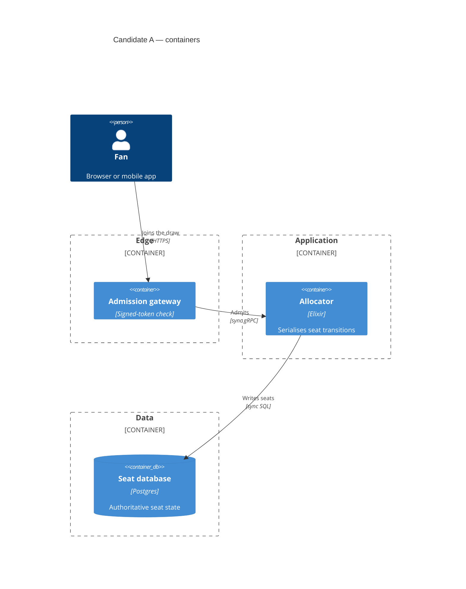
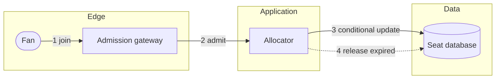
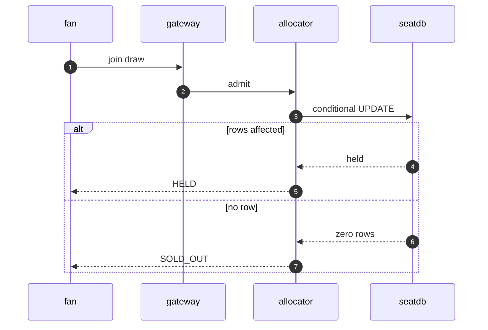

# Design document format

The artifact and format contract for [SKILL.md](SKILL.md): the records used from **Establish the current truth** onward, and the one document written at **Write and verify**—`DESIGN.md`, which is the source of truth.

## Contents

- [The one artifact](#the-one-artifact) · [Frontmatter](#frontmatter) · [Section order](#section-order)
- [Investigation register](#investigation-register)
- [Diagram choice](#diagram-choice) — one kind per design, how to choose it, and renderer limits
- [Component kinds](#component-kinds) — the vocabulary shared by tables and diagrams
- [Candidate records](#candidate-records) — components, contracts, flows, ratings
- [Supporting records](#supporting-records) — requirements, estimates, schemas, interfaces
- [The debt register](#the-debt-register) — repo mode only; the protocol lives in [AUDIT.md](AUDIT.md)
- [Verification](#verification) · [ADR on decision](#adr-on-decision-repo-mode) · [Vocabulary](#vocabulary)

## The one artifact

| Artifact | Location | Lifecycle |
|---|---|---|
| `DESIGN.md` | `docs/design/<slug>/` (git repo) or `./<slug>/` (no repo) | **DESIGN.md is the source of truth.** Every iteration edits this file in place; there is no JSON, rendered report, or generated copy |

A run writes only `DESIGN.md`, and at **Record the decision** the ADR and docs-index link the user accepts. Legacy `design.json` files are read-only migration inputs; never update them and never create new ones.

`## Notes` is user-owned. Preserve it verbatim on every update, and create it empty on first write.

## Frontmatter

```yaml
---
date: 2026-11-11
mode: greenfield        # repo | greenfield
status: draft           # draft | decided
decided: null           # candidate id once status is "decided"
observed:               # repo mode in git only; omit otherwise
  commit: 9fceb02d0ae598e95dc970b74767f19372d61af8
  uncommittedChanges: false
---
```

`mode`, `status`, `decided`, and `observed` carry the same meaning they carried in the old structured source. The H1 below the frontmatter is the title; the directory name is the slug.

A run creates a draft skeleton with this frontmatter and the headings below at **Locate and resume**, then fills it in place. Resuming reads this file before any new discovery.

## Section order

1. **Context** — problem, constraints, repository vocabulary adopted, the code the run read, and accepted conflicts.
2. **Investigation evidence and open questions** — evidence, questions, unknowns, and checks.
3. **Architectural debt** — repository mode only, omitted entirely in greenfield. An empty heading claims a survey that never ran.
4. **Requirements** — FR/NFR tables, top-three characteristics, excluded scope.
5. **Core entities and invariants**
6. **Data and consistency model**
7. **Database schemas**
8. **System interfaces**
9. **Estimates**
10. **Architectures** — opens with `Diagram kind:` and its one-line reason, then one `###` per candidate. Each candidate carries its thesis, diagram, component table, edge table, flows, trade-offs, migration notes, and ratings.
11. **Comparison and recommendation**
12. **Critical deep dives**
13. **Operations and rollout**
14. **Risks and what breaks first**
15. **Measurements that could overturn the decision**
16. **Next steps**
17. **Notes** — user-owned.

Debt sits beside Context because both describe the system that exists; everything after Requirements describes the one being proposed. Keep it away from Risks: a risk is a future failure with a horizon, a finding is a present defect with a cost.

## Investigation register

The register lives in the document; there is no separate runtime and no byte-hash checkpoint. Record each load-bearing claim as **observed**, **derived**, or **inferred**, with a source locator, scope, and limitations. A content locator identifies evidence; it does not authenticate the source or prove the claim.

### Evidence

| id | claim | type | scope | sources | limitations | freshness |
|---|---|---|---|---|---|---|
| `ev-order-commit` | The handler writes the order before returning success | observed | `src/orders.py` handler | `src/orders.py` | Static inspection does not prove a runtime commit | current |

### Questions

| id | question | status | evidence | answer |
|---|---|---|---|---|
| `q-durability` | When is an order durable? | answered | `ev-order-commit` | After the handler's write; runtime guarantees need a separate check |

### Unknowns

| id | question | status | evidence | resolution |
|---|---|---|---|---|
| `u-restore` | Can the backup meet the recovery target? | open | — | Run and retain a timed restore |

### Checks

| id | check | status | evidence | detail |
|---|---|---|---|---|
| `c-ack` | Inspect the handler's acknowledgement ordering | pass | `ev-order-commit` | Source ordering matches the stated boundary; durability was not tested |

Question status is `open | partial | answered`; unknown status is `open | resolved`; check status is `pass | fail | unknown`. A completed record cites fresh evidence and nonempty result text; the host still judges whether the evidence is sufficient.

**Freshness is a judgment, not a digest.** On resume, re-read the cited sources, including staged, unstaged, and untracked work, then update `freshness` to `current`, `stale`, or `unknown`. Changed or inaccessible evidence invalidates dependent completed records until it is re-established. There is no automatic invalidation, checkpoint, or recovery command; say what was actually re-read rather than claiming a check that did not run. Missing coverage establishes neither absence nor refutation.

## Diagram choice

Every candidate needs a readable shape, and a flow gets a diagram only when it earns one. The document uses **one diagram kind for the whole design**, chosen by the agent from context—not a fixed mix.

### The kinds

| Kind | Choose it when | It cannot express |
|---|---|---|
| **C4 structure** | The load-bearing question is ownership, boundaries, deployment units, or integrations; flows are secondary | Step order, branches, retries |
| **Flowchart** | The document must show component topology **and** control flow, branches, retries, or state transitions | Precise time ordering across many actors, though numbered edges approximate it |
| **Sequence** | The load-bearing question is time-ordered interaction, async handoff, timeout, or retry across a few participants | Static topology, many components, complex branching |

Default when both structure and flow are load-bearing: **flowchart**, because it is the only single kind that carries both.

### How to choose

1. State the primary question the diagrams must answer: what owns what, what can happen next, or who talks to whom in what order.
2. Select the one kind whose column answers that question. If the kind cannot carry a secondary dimension, plan a table for it—not a second kind.
3. If two kinds are genuinely tied and the choice changes what the reader can see, ask the user with a recommended default. If no user is present, take the default and mark it `assumed`.
4. Record the choice in the document before the first diagram:

   ```markdown
   Diagram kind: flowchart
   Why: the candidates differ in topology and the critical flows branch on seat-state transitions.
   ```

5. Use only that kind for every diagram in the document. A diagram of another kind is a contract defect, not a stylistic choice.

A diagram that only restates the chosen kind is not worth drawing. A simple linear flow gets a step table, and a closed option gets a one-line rejection with no diagram.

**Budget.** One structure diagram per candidate, and one diagram per critical flow. If a candidate has more than three critical flows, the extra flows are step tables unless a diagram is load-bearing.

### C4 structure

When the chosen kind is C4, use `C4Context` once when the system boundary is unclear and `C4Container` per candidate. Use `C4Component` only when one container's internals are the decision, and `C4Deployment` only when placement is the decision. Aliases are the candidate's stable component ids.

- `Person` or `Person_Ext` for end users.
- `System`/`System_Ext` for a system boundary at context level.
- `Container`, `ContainerDb`, `ContainerQueue`, and their `_Ext` variants for services, stores, queues, and third parties.
- `Container_Boundary` or `System_Boundary` for zones.
- `Rel(from, to, "label", "protocol")` for every edge. Mark `sync` or `async` in the label.
- `UpdateLayoutConfig` only when the default layout is unreadable.

C4 has a fixed palette, no tags, no links, and no legend. Its layout follows statement order, and `RelIndex` ignores its index and numbers relationships in statement order. Put deadlines, retry owners, backlog bounds, and state contracts in the tables below the diagram, never in the diagram labels. Flows are step tables, not a second diagram kind.



### Flowchart

When the chosen kind is flowchart, use `flowchart LR` for request-shaped logic and `flowchart TB` for pipelines. Use `flowchart` for both structure and flows, with zone subgraphs for topology. Keep every alias equal to a component id. Number the steps in edge labels (`1`, `2`, `3`) so the prose table can cite them. Use `-.->` for asynchronous work and a labelled edge for a stream.



### Sequence

When the chosen kind is sequence, use `sequenceDiagram` with `autonumber` for every flow. Declare participants in flow order. Use `alt`/`else` for accepted, rejected, and timed-out outcomes, `par` for fan-out, `loop` for retries, and `Note over` for an invariant, deadline, idempotency key, or retry owner. Structure is a component table, not a second diagram kind.



### Cross-references and portability

- Every diagram alias must exist in that candidate's component table, and every flow step must name components that exist.
- Keep labels short, avoid unescaped `;`, `#`, and unmatched parentheses, and quote labels that contain punctuation.
- Mermaid has no include or reuse mechanism, so each diagram repeats the aliases it needs. Keep the repetition to ids and short labels; the contracts live in the tables.
- GitHub, VS Code, and Obsidian render `flowchart` and `sequenceDiagram` reliably. C4 support depends on the Mermaid version in the renderer.
- If no renderer is available, write the diagrams, verify their syntax against the documented Mermaid grammar, and record rendering as **unknown**—never as passed.

## Component kinds

`kind` selects the symbol. The same kind list is used in every candidate. The C4 and flowchart columns describe how that kind renders when one of those families is the chosen diagram kind; when the chosen kind is sequence, the component id is the participant and those columns are unused.

| kind | C4 element | Flowchart shape | Use for |
|---|---|---|---|
| `person` | `Person` / `Person_Ext` | stadium | End users, browsers |
| `mobile` | `Person` / `Container_Ext` | stadium | Mobile apps |
| `service` | `Container` | hexagon or rectangle | Stateless app services, monolith modules |
| `gateway` | `Container` | double-bordered rectangle | API gateways, edge auth |
| `lb` | `Container` | diamond | Load balancers, traffic routing |
| `ws` | `Container` | double-bordered hexagon | Persistent-connection gateways |
| `worker` | `Container` | rounded rectangle | Async workers, consumers |
| `cron` | `Container` | circle | Schedulers, periodic jobs |
| `db-sql` | `ContainerDb` | cylinder | Relational stores |
| `db-nosql` | `ContainerDb` | stacked cylinder | KV, wide-row, document stores |
| `db-graph` | `ContainerDb` | connected nodes | Graph stores |
| `cache` | `ContainerDb` | lightning chip | In-memory caches |
| `queue` | `ContainerQueue` | striped pipe | Queues, task buffers |
| `stream` | `ContainerQueue` | arrowed log | Replayable logs, event streams |
| `blob` | `ContainerDb` | bucket | Object storage |
| `cdn` | `Container` | globe | Edge delivery |
| `search` | `ContainerDb` | magnifier | Search and inverted indexes |
| `ml` | `Container` | sparkline chip | Model inference, ranking |
| `ledger` | `ContainerDb` | double-entry book | Append-only financial records |
| `monitor` | `Container` | pulse | Observability |
| `external` | `System_Ext` / `Container_Ext` | plug | Third-party APIs |

A client-side architecture uses the same kinds: `mobile` or `person` for the shell, `service` for a state owner or sync engine, `db-sql`/`db-nosql` for the on-device store, `cache` for an in-memory tier, `queue` for a mutation outbox, `worker` for background refresh.

## Candidate records

### Components

| id | name | kind | zone | tech | note | state contract | change |
|---|---|---|---|---|---|---|---|
| `chat-svc` | Chat service | `service` | app | Elixir | 100k conns/node | — | modified |
| `msg-store` | Message store | `db-nosql` | data | — | Append-only history | authoritative; ack quorum WAL commit; zones; RPO 0; RTO <60 s; fenced promotion | unchanged |

`id` is stable across every architecture in the document. `zone` is `edge | app | data | async | external`. `change` is `added | removed | modified | unchanged` and is omitted in greenfield.

### State contracts

An authoritative component supplies:

- **acknowledgement** — the exact durable event after which success may be exposed;
- **failure domain** — the independent failure scope covered by that acknowledgement;
- **RPO** — maximum acceptable data loss or recovery-point age, scoped by failure;
- **RTO** — maximum acceptable recovery time, scoped by failure;
- **recovery** — the tested promotion or restore procedure.

A derived component supplies **source** (the complete authoritative reconstruction input) and **cursor** (the durable position proving how far the source has been applied). Do not put `UNKNOWN` in authoritative lifecycle state: authoritative operations use `PENDING | RECONCILING | SUCCEEDED | FAILED | CANCELLED`; `UNKNOWN` is only the caller's observation after an ambiguous timeout.

### Edges and dependency contracts

| from | to | kind | label | deadline | retry owner | backlog bound | contract notes |
|---|---|---|---|---|---|---|---|
| `lb` | `chat-svc` | sync | WSS | 500 ms of caller budget | load balancer, once with jitter | 2k in-flight calls/instance; shed above it | — |

`kind` is `sync | async | stream`. `deadline` is the caller-visible completion budget for a synchronous edge, or the maximum acceptable age or handoff deadline for an asynchronous or log edge. `retry owner` names exactly one layer or consumer. `backlog bound` names the finite concurrency, queue, retention, or lag bound and the saturation action. `n/a` is valid only when it states why the dimension cannot apply and names the alternative finite bound.

### Flows

Each flow carries an id, a name, the diagram (or a stated reason for none), and a step table.

| seq | from | to | label | note |
|---|---|---|---|---|
| 1 | `client` | `lb` | WSS frame | client-generated message id makes retries idempotent |

Critical flows include the happy path and the failure and recovery paths. Every step references component ids present in that candidate.

### Trade-offs, migration, and ratings

- **Pros/cons:** at least one honest weakness per candidate.
- **Migration (repo mode):** `S` = one release, no data migration; `M` = staged across a few releases or one bulk migration; `L` = a compatibility path that runs beside the old one. State what data moves and whether rollback survives once users write the new format.
- **Ratings:** a table with one row per candidate and one column per axis, 1–5; `cost` is 5 = cheapest. Architecture 0 is rated too.

| candidate | deployability | elasticity | evolvability | faultTolerance | modularity | cost | performance | reliability | scalability | simplicity | testability |
|---|---|---|---|---|---|---|---|---|---|---|---|
| `current` | 4 | 2 | 3 | 3 | 4 | 4 | 3 | 4 | 3 | 4 | 4 |

## Supporting records

### Requirements

FR/NFR tables, excluded scope, `requirements.priorities.top3` (exactly three ratings axes), and accepted conflicts. Every axis in `top3` also appears in the comparison.

### Data model and schemas

For each core entity: representation in memory and at rest, identity scheme, ordering authority, conflict resolution per field class, durability point, and garbage collection or compaction.

For every structured store, give an intuitive, non-executable schema: name each table or collection, list only the fields that explain the design, mark primary, partition, sort, and deduplication keys, and state important indexes, relationships, source-of-truth status, and retention notes. Use human-readable cards; no executable DDL.

### Interfaces

For each boundary: name, style and transport, purpose, trust boundary, deadline, retryability, backpressure, consistency and idempotency scope, compatibility direction, and caller-visible failure result including `UNKNOWN`.

### Estimates

Assumptions tagged `user` or `assumed`, and a table of metric, value, and derivation. Show derivations and verify arithmetic with a shell command. Record a standard metric that does not apply as `n/a` with a one-line reason.

## The debt register

Repository mode only. The protocol—what counts as debt, the pipeline, categories, severity, and identity—lives in [AUDIT.md](AUDIT.md). This section is the storage format.

### Coverage

```markdown
### Coverage

- **Checked:** boundaries, data-ownership, coupling, dependency-contracts,
  failure-containment, over-engineering, obsolescence.
- **Unverified:** `change history before 2026-01` — shallow clone; nine months available.
```

`Checked` names every category the audit ran, so a category that produced nothing reads as examined rather than skipped. `Unverified` records every check that wanted evidence the run could not reach.

### Findings

Group by category only when the volume earns it. Order by severity, then confidence. Keep open findings first, then accepted findings, then absent findings in their own subsection.

```markdown
#### `dbt-shared-persistence--billing-svc-orders-db` — Billing and fulfilment both write the orders table

| Field | Value |
|---|---|
| Subject | repo |
| Category | data-ownership |
| Pattern | shared-persistence |
| Components | `billing-svc`, `orders-db` |
| Consequence / exposure | breaking / on-path |
| Severity / confidence | blocking / high |
| Evidence | Both map orders as authoritative — `billing/models.py`; `fulfilment/schema.sql` |
| Why it matters | A column added for billing cannot ship until fulfilment has been read and re-tested. |
| Remedy | `consolidate` — one owner writes orders; the other reads a view it does not migrate. Effort `M`; reversible. |
| Blast radius | every migration touching orders |
| Resolved by | `b` |
| Disconfirming | ADR-0004 records the shared table, but for reads only — writes were never decided. |
| Verification | real pass; live pass; lenses: uncovered not refuted ("ADR-0004 covers reads, not writes"); unstated not refuted ("no trade-off is recorded"); tools: repository, change history; survived 2 |
| Status / justification / accepted until | open / — / — |
| First seen / baseline | 2026-08-11 / new |
```

A `note`-shaped finding—an observation with no remedy—omits severity, consequence, and exposure. Severity is looked up from the two axes and never chosen. A finding never carries a numeric score, a debt index, or an estimate in hours or currency.

Identity is `dbt-<pattern>--<sorted component ids>` and nothing else. Read the prior `DESIGN.md` and index every finding by its id and every alias before the finder runs. Carry forward `status`, `justification`, `acceptedUntil`, `firstSeen`, and `aliases` verbatim; regenerate prose, evidence, remedy text, blast radius, and the disconfirming line. `baselineState` is `new | unchanged | updated | absent`, present on every finding or on none.

## Verification

Before the run is complete, check the document directly:

1. Frontmatter parses as YAML and `mode`, `status`, and `decided` are consistent.
2. The required headings appear in the stated order, and `Notes` is present.
3. The document records exactly one diagram kind and gives its reason, and every Mermaid block uses that kind.
4. Every component id used in a diagram, edge, flow, or finding exists in that candidate's component table.
5. Every flow step references existing components; every critical flow has a diagram or a stated reason for none.
6. Every evidence, question, unknown, check, and finding reference resolves.
7. Every debt finding has a stable id and the merge fields.
8. Every Mermaid block's aliases resolve.
9. The document states what was re-read, what was not verified, and which renderer, if any, was used.

Structural checks do not prove the architecture. Semantic review and diagram rendering remain separate results; missing rendering is unknown, not passed.

## ADR on decision (repo mode)

Offer once, when the user picks a winner: `docs/adr/NNNN-<slug>.md` with Title (numbered noun phrase) · Status (Accepted; and `Superseded by NNNN` written back into any ADR this replaces) · Context (the forces, the rejected candidates by name with the reason each lost, and the documents that previously owned this subject) · Decision (affirmative voice: "We will…") · Consequences (the trade-offs accepted, good and bad). Future runs read `docs/adr/` at **Establish the current truth** and do not re-litigate.

## Vocabulary

**Use exactly:** architecture, candidate, component, flow, step, zone, edge, envelope, estimate, characteristic, trade-off, recommendation, finding, debt, severity, remedy, evidence.

**Never substitute:** box, node, block (for component) · path, journey (for flow) · lane, tier, layer (for zone) · option, variant (for candidate — a variant is what fails the distinctness rule) · issue, problem, violation (for finding — a violation names a rule that was broken, which is only one of the seven things a finding can be) · score, rating, grade (for severity — severity is looked up from two axes, and a number implies a precision nothing here has).
